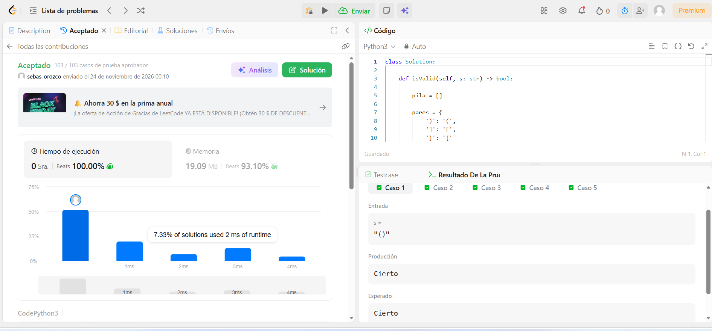
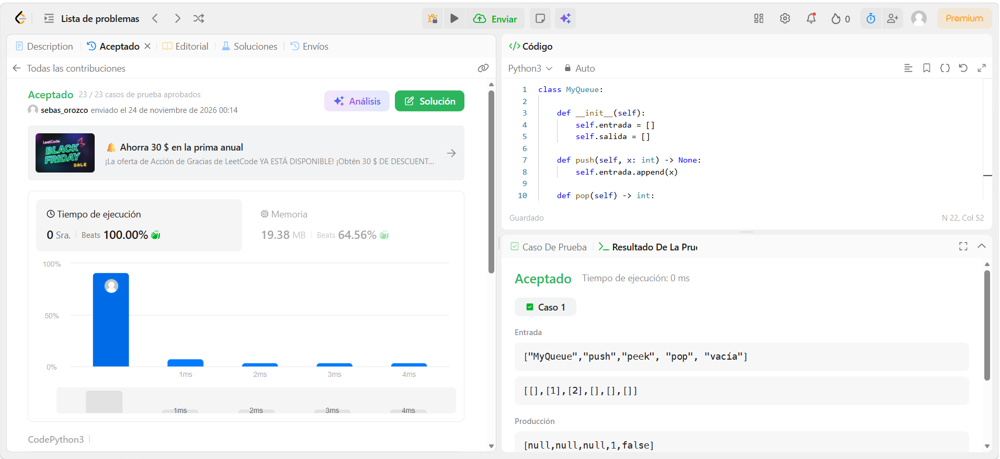
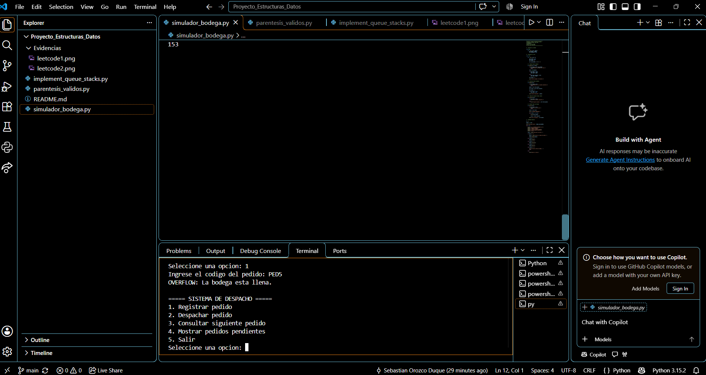
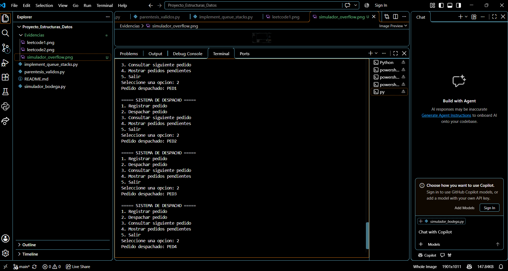
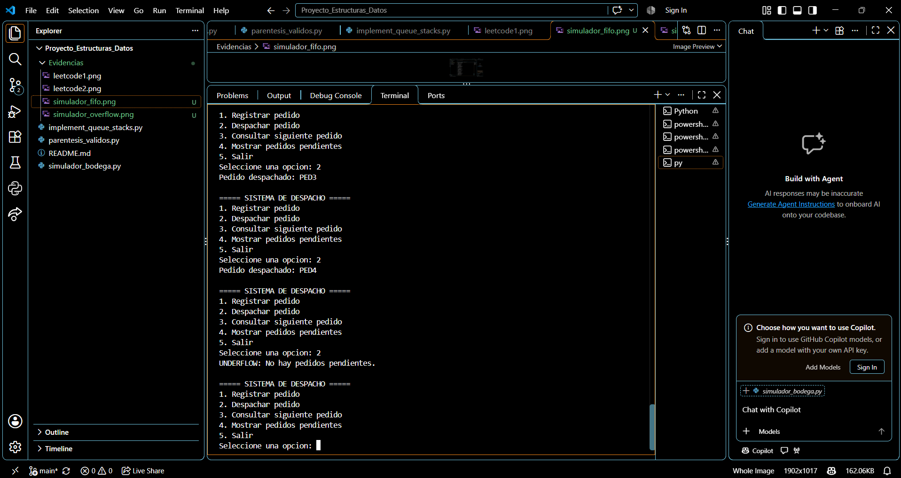

# Sistema de Gestión de Despacho de Pedidos en una Bodega

## 1. Información del equipo

**Programa:** Técnica Profesional en Programación de Software  
**Institución:** Corporación Instituto de Administración y Finanzas – CIAF  
**Asignatura:** Estructuras de Datos Lineales, Eficiencia Algorítmica y Resolución de Problemas.

### Integrantes

| Nombre completo | Número de lista |
|---|---:|
| Sebastián Orozco Duque | 13 |
| Miguel Ángel Sepúlveda | 21 |

Los integrantes se encuentran organizados alfabéticamente por apellido.

## 2. Cálculo de la capacidad máxima

De acuerdo con la regla establecida en la actividad, el valor de N corresponde al número de lista del primer integrante al ordenar al equipo alfabéticamente por apellido.

- Primer apellido: Orozco.
- Número de lista: 13.
- Valor de N: 13.

**Fórmula:**

`capacidadMax = (N % 4) + 3`

**Reemplazando:**

`capacidadMax = (13 % 4) + 3`

`capacidadMax = 1 + 3`

**Capacidad máxima = 4 pedidos.**

Por lo tanto, el simulador permite almacenar un máximo de cuatro pedidos simultáneamente.

## 3. Escenario seleccionado

El equipo seleccionó como escenario el sistema de gestión de despacho de pedidos en una bodega.

En este escenario, los pedidos llegan y se registran para posteriormente ser atendidos por el personal encargado del despacho.

Se eligió una estructura de datos lineal tipo **Cola (Queue)** porque representa adecuadamente el orden de llegada de los pedidos.

La cola trabaja bajo el principio FIFO (First In, First Out), que significa que el primer pedido en ingresar es el primero en salir.

Esto permite mantener un orden justo y organizado durante el proceso de despacho.

## 4. Operaciones principales del simulador

El programa permite realizar las siguientes operaciones:

- **Agregar pedido:** registra un nuevo pedido al final de la cola.
- **Despachar pedido:** retira el primer pedido que ingresó.
- **Consultar siguiente pedido:** muestra cuál es el próximo pedido que debe despacharse sin retirarlo.
- **Mostrar pedidos pendientes:** presenta todos los pedidos que continúan en espera.
- **Salir:** finaliza la ejecución del programa.

### Control de capacidad

El simulador tiene una capacidad máxima de cuatro pedidos.

- **Overflow:** ocurre cuando se intenta agregar un quinto pedido mientras la cola está llena.
- **Underflow:** ocurre cuando se intenta despachar un pedido y la cola está vacía.

## 5. Implementación de la estructura de datos

El simulador fue desarrollado en Python mediante una implementación propia de una cola utilizando nodos enlazados.

La estructura utiliza referencias al primer y último nodo de la cola:

- Frente (front): apunta al primer pedido que debe atenderse.
- Final (rear): apunta al último pedido registrado.

Esta implementación permite agregar y retirar pedidos sin utilizar simplemente un arreglo desordenado.

### Archivos del proyecto

| Archivo | Descripción |
|---|---|
| `simulador_bodega.py` | Programa principal del sistema de despacho. |
| `parentesis_validos.py` | Solución del problema Valid Parentheses. |
| `implement_queue_stacks.py` | Solución del problema Implement Queue using Stacks. |

## 6. Retos de LeetCode

### Ejercicio 1: Valid Parentheses

**Plataforma:** LeetCode  
**Problema:** 20. Valid Parentheses  
**Nivel:** Easy  
**Estructura utilizada:** Pila (Stack).

**Descripción:**

El problema consiste en determinar si una cadena de caracteres contiene paréntesis, corchetes y llaves correctamente abiertos y cerrados.

Se utiliza una pila porque permite consultar y retirar el último elemento ingresado, siguiendo el principio LIFO (Last In, First Out).

**Complejidad temporal:** O(n).

Se recorren los caracteres de la cadena una sola vez. Por eso, el tiempo de ejecución aumenta proporcionalmente al tamaño de la entrada.

**Complejidad espacial:** O(n).

En el peor caso, la pila puede almacenar hasta n caracteres si todos los símbolos de apertura aparecen antes de sus respectivos cierres.

**Resultado:** Accepted.

**Evidencia de LeetCode:**

### Ejercicio 2: Implement Queue using Stacks

**Plataforma:** LeetCode  
**Problema:** 232. Implement Queue using Stacks  
**Nivel:** Easy  
**Estructuras utilizadas:** Dos pilas (Stacks).

**Descripción:**

El problema consiste en implementar una cola utilizando dos pilas.

Se utilizan dos estructuras:

- Pila de entrada: almacena los elementos nuevos.
- Pila de salida: permite retirar los elementos conservando el orden FIFO.

Cuando la pila de salida está vacía, los elementos de la pila de entrada se transfieren a ella. De esta manera, el primer elemento ingresado queda disponible para salir primero.

**Complejidad temporal:**

- `push`: O(1).
- `pop`: O(1) amortizado.
- `peek`: O(1) amortizado.
- `empty`: O(1).

Las operaciones `pop` y `peek` pueden necesitar O(n) en el peor caso cuando se transfieren los elementos de una pila a otra. Sin embargo, cada elemento se transfiere como máximo una vez, por lo que su costo amortizado es O(1).

**Complejidad espacial:** O(n).

Se utilizan dos pilas para almacenar los elementos de la cola.

**Resultado:** Accepted.

**Evidencia de LeetCode:**

## 7. Análisis de eficiencia del simulador

Las operaciones principales del simulador presentan las siguientes complejidades:

| Operación | Complejidad temporal |
|---|---|
| Agregar pedido | O(1) |
| Despachar pedido | O(1) |
| Consultar siguiente pedido | O(1) |
| Mostrar pedidos pendientes | O(n) |

**Complejidad espacial:** O(n), porque se utiliza memoria para almacenar los nodos de los pedidos pendientes.

La implementación mediante nodos enlazados permite insertar y retirar elementos en tiempo constante, utilizando las referencias al frente y al final de la cola.

## 8. Evidencias de ejecución del simulador

### 8.1. Prueba de Overflow

Se registran cuatro pedidos, alcanzando la capacidad máxima permitida. Posteriormente, se intenta agregar un quinto pedido y el sistema rechaza la operación mostrando el mensaje de desbordamiento.

### 8.2. Prueba de FIFO

Se registran los pedidos PED-001, PED-002, PED-003 y PED-004. Al despacharlos, el sistema los atiende en el mismo orden en que fueron registrados.

Esto demuestra el funcionamiento de la política FIFO.

### 8.3. Prueba de Underflow

Después de despachar todos los pedidos, se intenta retirar otro elemento de la cola vacía. El sistema controla la situación y muestra el mensaje de Underflow.

## 9. Tecnologías utilizadas

- Lenguaje de programación: Python.
- Plataforma de retos algorítmicos: LeetCode.
- Control de versiones: Git.
- Repositorio: GitHub.
- Editor y terminal: Visual Studio Code y PowerShell.

## 10. Conclusión

Mediante el desarrollo de este proyecto se aplicaron los conceptos de estructuras de datos lineales, especialmente el funcionamiento de las pilas y las colas.

Los ejercicios de LeetCode permitieron practicar la resolución de problemas algorítmicos y analizar su eficiencia temporal y espacial mediante la notación Big-O.

Por otra parte, el simulador permitió aplicar una cola implementada mediante nodos enlazados en un escenario práctico de despacho de pedidos, incorporando controles de capacidad máxima, Overflow y Underflow.

Finalmente, el proyecto fortaleció los conocimientos sobre programación, lógica algorítmica, estructuras de datos y trabajo colaborativo.
